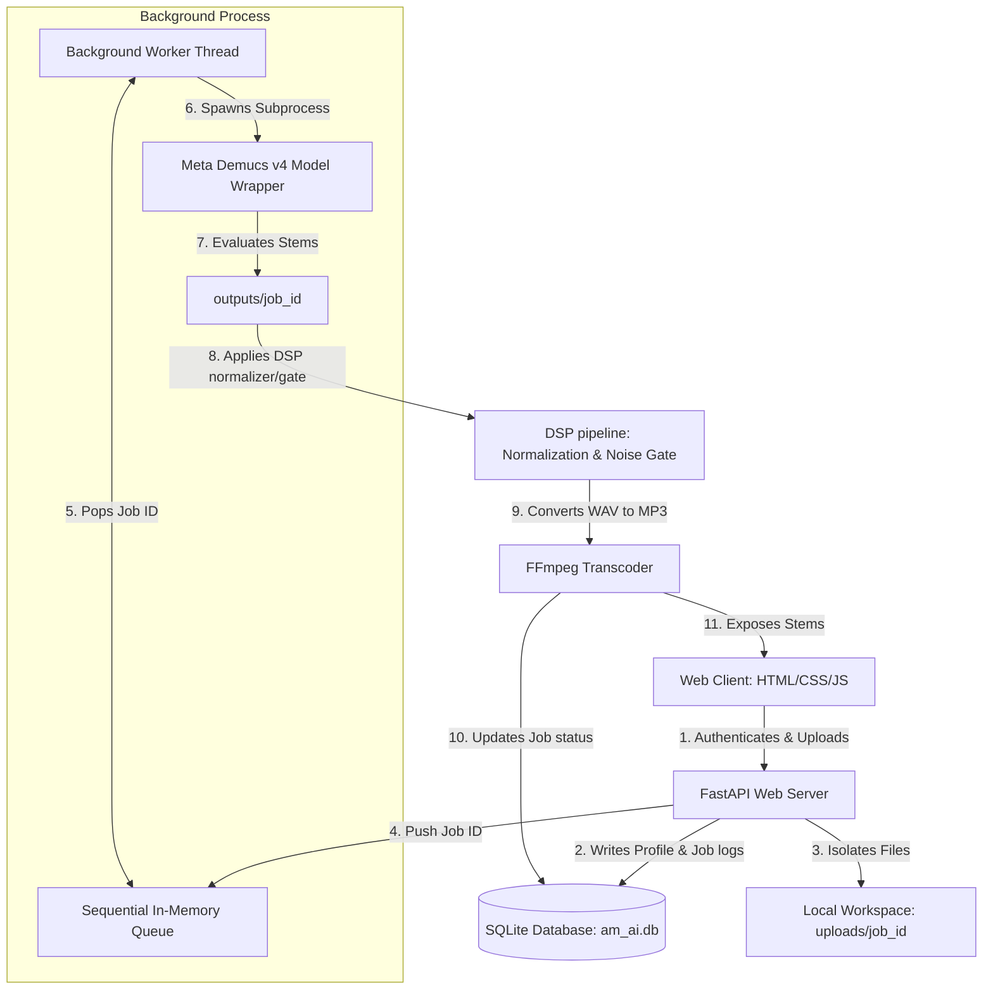

# AM AI Audio Lab — Enterprise-Grade Audio Stem Separator

[](https://www.python.org/)
[](https://fastapi.tiangolo.com/)
[](https://pytorch.org/)
[](https://www.docker.com/)
[](LICENSE)

**AM AI Audio Lab** is an advanced, production-quality source separation and vocal isolation web application. It isolates vocals, drums, bass, piano, guitar, and instrumentals from uploaded audio using **Meta's Demucs v4 (Hybrid Transformer)** neural networks. 

Engineered with a **FastAPI** backend, **SQLite** persistence, secure cryptographically-signed session state storage, and a responsive **glassmorphic vanilla CSS frontend** featuring custom animated canvas visualizers powered by **Wavesurfer.js**.

---

## 🏗️ System Architecture

The application is architected to prioritize security, resource isolation, and system stability under heavy multi-user workloads:



### 🗝️ Core Architectural Decisions

1.  **Thread-Safe SQLite Persistence**: Built using raw parameterized SQL operations with connection pools configured using `check_same_thread=False` to handle FastAPI's asynchronous thread states securely.
2.  **Sequential background Task Queue**: Audio separation models (especially Hybrid Transformers) are highly memory-intensive. Running multiple jobs in parallel can trigger CUDA Out-Of-Memory (OOM) errors or exhaust system RAM. To prevent this, all jobs are loaded into a thread-safe, sequential queue worker that processes separations one at a time.
3.  **Cryptographic Session-Cookie Auth**: Session management uses Starlette's `SessionMiddleware` using cryptographically signed cookies (via `itsdangerous`). This keeps the system lightweight, secure, and avoids session hijacking without needing external auth brokers.
4.  **Hardware Auto-Detection**: The model wrapper automatically detects the system's hardware configurations, defaulting to NVIDIA CUDA acceleration or Apple MPS (Metal Performance Shaders) before falling back to CPU cores.

---

## 🎚️ Live Studio Mixer & Multi-Stem DAW Features

Global Release v1.0 elevates AM AI from a stem separator into a full in-browser digital audio workstation (DAW):

*   **Synchronized Multi-Track Engine**: Stems play in sample-accurate phase lock with master play/pause controls.
*   **Solo [S] & Mute [M] Controls**: Isolate single elements (e.g., pure vocals) or silence specific channels for instant karaoke backing tracks or drumless practice tracks.
*   **A/B Real-Time Comparison Switch**: Instantly toggle between the raw uploaded song and the isolated stems mix at the exact millisecond playhead position.
*   **Variable Speed Controller**: Shift playback speeds smoothly (`0.75x`, `1.0x`, `1.25x`, `1.5x`) for learning fast riffs or transcribing intricate solos.
*   **Active Equalizer Visualizers**: Real-time CSS-animated frequency spectrum bars provide instant feedback for active stems.
*   **First-Time User Interactive Tour**: A 4-step glassmorphic onboarding walkthrough guides new users through models, mixer controls, and export settings.

---

## 🎛️ DSP & Audio Engineering Pipeline

Separated neural network stems often suffer from bleed-through noise, low gain outputs, or digital artifacts. AM AI runs a post-processing pipeline to refine output quality:

*   **Smart Peak Normalization**: Automatically scales separated stems to peak volume levels of `-1.0 dBFS` (absolute amplitude `0.891`), maximizing loudness while safeguarding against clipping distortion.
*   **Adaptive Noise Gate**: Applies a noise envelope gate below a threshold of `-55 dBFS` (`0.0018` amplitude). Signal envelopes below this threshold are attenuated by `85%`, and signal segments below `0.00072` are forced to absolute `0.0` to eliminate residual bleed and noise during silent intervals.
*   **Bitrate Transcoding**: WAV stems are dynamically transcoded to maximum-bitrate `320kbps MP3` structures using FFmpeg (falls back to WAV if FFmpeg is absent) to reduce client load times and conserve disk storage.

---

## 📁 Repository Directory Map

```text
AM_AI/
├── app.py                  # API routes, session security configurations, and task scheduler
├── database.py             # SQLite interface mapping user registers, tasks, and file parameters
├── requirements.txt        # Backend dependencies manifest
├── README.md               # System documentation & developer walkthrough
├── Dockerfile              # Container configuration optimized for minimal CPU wheels
├── docker-compose.yml      # Docker service orchestrator mapping persistent host volumes
├── templates/
│   ├── index.html          # Main single-page application dashboard workspace
│   ├── login.html          # Glassmorphic user sign-in page with validation error cues
│   └── register.html       # Glassmorphic user signup page with confirm-password checks
└── static/
    ├── css/
    │   └── style.css       # Hardware-accelerated transitions & keyframe styles
    └── js/
        └── main.js         # Frontend controller, API poller, and Wavesurfer visualizer
```

---

## 🚀 Installation & Local Environment Setup

### 1. Install System FFmpeg
FFmpeg is required to handle mp3, flac, m4a, and ogg formats:
*   **Windows (PowerShell Admin)**:
    ```powershell
    winget install Gyan.FFmpeg
    ```
*   **macOS**:
    ```bash
    brew install ffmpeg
    ```
*   **Linux (Ubuntu/Debian)**:
    ```bash
    sudo apt update && sudo apt install -y ffmpeg
    ```

### 2. Configure Virtual Environment & Dependencies
1. Navigate to the project directory:
   ```bash
   cd AM_AI
   ```
2. Create and activate a Python virtual environment:
   ```bash
   python -m venv venv
   # Windows:
   .\venv\Scripts\Activate.ps1
   # macOS/Linux:
   source venv/bin/activate
   ```
3. Install PyTorch matching your hardware specifications:
   *   **GPU Acceleration (NVIDIA CUDA 12.1)**:
       ```bash
       pip install torch torchaudio --index-url https://download.pytorch.org/whl/cu121
       ```
   *   **CPU Mode**:
       ```bash
       pip install torch torchaudio
       ```
4. Install remaining requirements:
   ```bash
   pip install -r requirements.txt
   ```

### 3. Launch FastAPI Server
```bash
python app.py
```
Open your browser and navigate to **`http://127.0.0.1:8000`** to log in and use the application.

---

## 🐳 Containerized Production Deployment

The project is packaged for rapid container deployment using Docker and Docker Compose:

### Run Service
```bash
docker-compose up --build -d
```
Docker compose maps directories for `./uploads`, `./outputs`, and your `./am_ai.db` SQLite database to the local host machine, preserving user accounts and processed files across rebuilds.

---

## 👨‍💻 Author & Engineering Credits

This project was developed and is maintained by **Shaik Arshad Hussain**:
*   **GitHub**: [@ArshadHussain-sk](https://github.com/ArshadHussain-sk)
*   **Email**: [urstrulyarshad@gmail.com](mailto:urstrulyarshad@gmail.com)

*Portfolio Highlights:* This project demonstrates professional proficiency in backend architecture design, database optimization, multi-threaded background queues, digital signal processing (DSP) workflows, containerization scripts, and responsive user-experience micro-animations.
