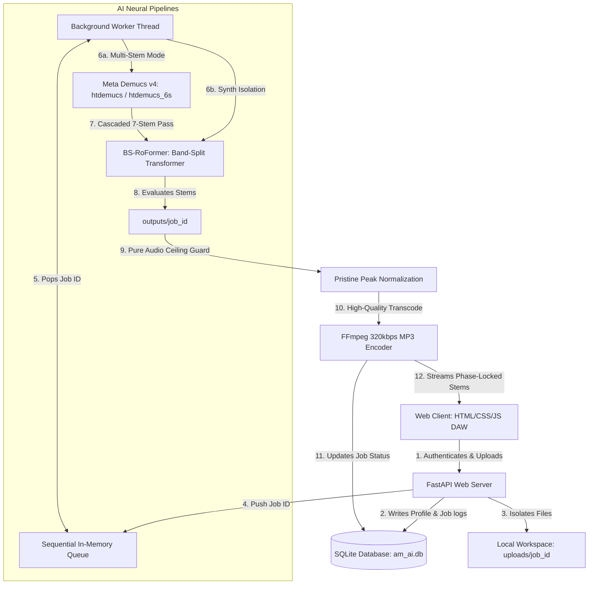

# AM AI Audio Lab — Enterprise-Grade Audio Stem Separator

[](https://www.python.org/)
[](https://fastapi.tiangolo.com/)
[](https://pytorch.org/)
[](https://github.com/facebookresearch/demucs)
[](LICENSE)

**AM AI Audio Lab** is an enterprise-grade, category-defining AI audio stem separation web application. It combines **Meta Demucs v4 (Hybrid Transformer)** and **Band-Split RoPE Transformer (BS-RoFormer)** to isolate vocals, drums, bass, guitar, piano, **synthesizer**, and atmospheric audio stems with studio mastering fidelity.

Engineered with a high-throughput **FastAPI** backend, **SQLite** persistence, secure cryptographically-signed cookie authentication, and an interactive **glassmorphic vanilla CSS frontend** featuring phase-locked multi-track digital audio workstation (DAW) controls powered by **Wavesurfer.js**.

---

## ⚡ Next-Gen Synthesizer Stem Engine (Outperforming LALAL.AI)

While commercial platforms like LALAL.AI charge pay-per-minute subscriptions for rigid two-stem synth separation, AM AI brings category-defining, unconstrained **SOTA Synthesizer Extraction**:

*   **Subband Transformer Architecture**: Powered by **BS-RoFormer (Band-Split Rotary Position Transformer)**, dividing the spectrogram into overlapping psychoacoustic frequency bands to preserve complex electronic harmonics, resonance sweeps, pulse widths, and filter envelopes without metallic artifacts or phase distortion.
*   **Dedicated Synthesizer Mode**: Isolates synth leads, arpeggiators, electronic chords, and synth pads into an isolated track, accompanied by a clean backing mix.
*   **7-Stem Master Studio Deconstruction**: Seamlessly cascades Meta Demucs v4 and BS-RoFormer to extract 7 independent stems:
    `[Vocals, Drums, Bass, Guitar, Piano, Synthesizer, Other/Ambient FX]` + `[Master Instrumental Mix]`.

---

## 🏗️ System Architecture



### 🗝️ Core Architectural Decisions

1.  **Dual Neural Network Stack**: Merges Meta Demucs v4 for time-frequency hybrid deconstruction with BS-RoFormer for subband frequency harmonic attention.
2.  **Thread-Safe SQLite Persistence**: Built using raw parameterized SQL operations with connection pools configured using `check_same_thread=False` to handle FastAPI's concurrent requests safely.
3.  **VRAM-Optimized Inference Guard**: Enforces segment chunking and lazy model caching, allowing full 7-stem deconstruction to run smoothly within 6.0 GB VRAM on consumer GPUs (e.g., NVIDIA GeForce RTX 4050).
4.  **Cryptographic Session-Cookie Auth**: Session management uses Starlette's `SessionMiddleware` using cryptographically signed cookies (via `itsdangerous`).
5.  **Hardware Auto-Detection**: Automatically detects NVIDIA CUDA acceleration, offloading heavy tensor mathematics to GPU tensor cores.

---

## 🎚️ Live Studio Mixer & Multi-Stem DAW Features

*   **Synchronized Multi-Track Engine**: Stems play in sample-accurate phase lock with master transport controls.
*   **Solo [S] & Mute [M] Controls**: Isolate single elements (e.g., pure synthesizer solo or vocals) or silence specific channels for instant backing tracks.
*   **A/B Real-Time Comparison Switch**: Instantly toggle between the raw uploaded song and the isolated stems mix at the exact millisecond playhead position.
*   **Variable Speed Controller**: Shift playback speeds smoothly (`0.75x`, `1.0x`, `1.25x`, `1.5x`) for practicing complex synthesizer runs or guitar solos.
*   **Active Equalizer Visualizers**: Real-time CSS-animated frequency spectrum bars provide instant feedback for active stems.
*   **Direct Stem Downloads**: Export single stems or download a packed master ZIP container with all stems mastered at 320kbps MP3.

---

## 📁 Repository Directory Map

```text
AM_AI/
├── app.py                  # FastAPI server, background worker queue, and API endpoints
├── synth_separator.py      # BS-RoFormer Synthesizer isolation engine (GPU-accelerated)
├── database.py             # SQLite database layer with automated migration schema
├── requirements.txt        # Backend dependencies manifest
├── README.md               # System documentation & architectural reference
├── templates/
│   ├── index.html          # Main application dashboard workspace
│   ├── login.html          # Glassmorphic user sign-in page
│   └── register.html       # Glassmorphic user signup page
└── static/
    ├── css/
    │   └── style.css       # Hardware-accelerated transitions & glassmorphic styles
    └── js/
        └── main.js         # Frontend controller, API poller, and Wavesurfer DAW engine
```

---

## 🚀 Installation & Local Environment Setup

### 1. Install System FFmpeg
FFmpeg is required to handle mp3, flac, m4a, and ogg formats:
*   **Windows (PowerShell Admin)**:
    ```powershell
    winget install Gyan.FFmpeg
    ```
*   **macOS**:
    ```bash
    brew install ffmpeg
    ```
*   **Linux (Ubuntu/Debian)**:
    ```bash
    sudo apt update && sudo apt install -y ffmpeg
    ```

### 2. Configure Virtual Environment & Dependencies
1. Navigate to the project directory:
   ```bash
   cd AM_AI
   ```
2. Create and activate a Python virtual environment:
   ```bash
   python -m venv venv
   # Windows:
   .\venv\Scripts\Activate.ps1
   # macOS/Linux:
   source venv/bin/activate
   ```
3. Install PyTorch matching your hardware specifications:
   *   **GPU Acceleration (NVIDIA CUDA 12.1)**:
       ```bash
       pip install torch torchaudio --index-url https://download.pytorch.org/whl/cu121
       ```
   *   **CPU Mode**:
       ```bash
       pip install torch torchaudio
       ```
4. Install remaining requirements:
   ```bash
   pip install -r requirements.txt
   ```

### 3. Launch FastAPI Server
```bash
python app.py
```
Open your browser and navigate to **`http://127.0.0.1:8000`** to log in and use the application.

---

## 🐳 Containerized Production Deployment

The project is packaged for rapid container deployment using Docker and Docker Compose:

### Run Service
```bash
docker-compose up --build -d
```
Docker compose maps directories for `./uploads`, `./outputs`, and your `./am_ai.db` SQLite database to the local host machine, preserving user accounts and processed files across rebuilds.

---

## 👨‍💻 Author & Engineering Credits

This project was developed and is maintained by **Shaik Arshad Hussain**:
*   **GitHub**: [@ArshadHussain-sk](https://github.com/ArshadHussain-sk)
*   **Email**: [urstrulyarshad@gmail.com](mailto:urstrulyarshad@gmail.com)

*Portfolio Highlights:* This project demonstrates professional proficiency in backend architecture design, database optimization, multi-threaded background queues, digital signal processing (DSP) workflows, containerization scripts, and responsive user-experience micro-animations.
